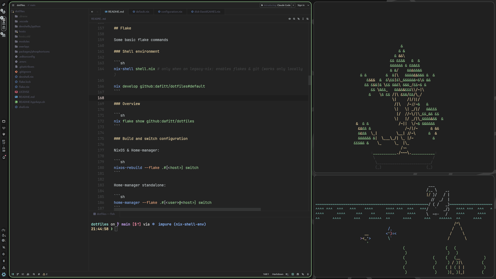

# My daily driver's NixOS❄️ desktop flake



<p align="center"><a href="#installation">Installation</a> &bull; <a href="#usage">Usage</a> &bull; <a href="#configuration">Configuration</a> &bull; <a href="#troubleshooting">Troubleshooting</a></p>

# Notes

This flake can and will radically change as I learn, discover new things and have new ideas.

## Most important features and programs

- 🏗 [github:numtide/blueprint](https://github.com/numtide/blueprint) nix flake❄️ structure
- 📦 [github:gmodena/nix-flatpak](https://github.com/gmodena/nix-flatpak) declarative flatpaks
- 🎨 [github:danth/stylix](https://github.com/danth/stylix) theming (modified [catppuccin](https://github.com/catppuccin) 🌿 [Mocha](https://github.com/catppuccin/catppuccin#-palette))
- 🪟 [GNOME](https://www.gnome.org/) with extensions
- 🪟 [Umbriel](https://docs.noctalia.dev/umbriel/) Wayland compositor

# Installation

## New machine - Using the official Installer

1. Install [NixOS](https://nixos.org/download/) and enable the nix feature "[flakes](https://wiki.nixos.org/wiki/Flakes#Enabling_flakes)"

2. **Dotfiles preparation** (mandatory changes to my dotfiles):

   1. `git clone https://github.com/dafitt/dotfiles.git`
   2. `cd dotfiles`
   3. Read and understand my dotfiles' structure and code

   4. Add (**your own**) system-configuration to _`hosts/<host>/configuration.nix`_.
      - Copy and import _`hardware-configuration.nix`_
      - Set the correct current `system.stateVersion`

   5. Add (**your own**) home-configuration(s) to _`hosts/<host>/users/<user>.nix`_

   6. Commit all changes:

      ```
      git add . && git commit -m "hosts/<host>: Added new host"
      ```

   7. Uncomment `nixConfig` in [flake.nix](https://github.com/dafitt/dotfiles/blob/main/flake.nix) and enter `nix develop` on your first build for faster build time

3. Build:
   1. Enter (`nix-shell` and then) `nix develop .#default`
   2. `sudo nixos-rebuild --flake .#<host> boot`
   3. Check for home-manager errors with `systemctl status home-manager-<user>.service` and resolve them if necessary
   - _NOTE: First install may take some time; especially with flatpaks enabled._

4. `reboot`

## New standalone home environment

1. Install [nix](https://nixos.org/download/) and enable the nix feature "[flakes](https://wiki.nixos.org/wiki/Flakes#Other_Distros,_without_Home_Manager)"

2. **Dotfiles preparation** (mandatory changes to my dotfiles):

   1. `git clone https://github.com/dafitt/dotfiles.git`
   2. `cd dotfiles`
   3. Read and understand my dotfiles' structure and code

   4. Add (**your own**) home-configuration to _`hosts/<host>/users/<user>.nix`_
      - Set the correct current `home.stateVersion`

   5. Commit all changes:

      ```
      git add . && git commit -m "hosts/<host>: Added new home"
      ```

   6. Uncomment `nixConfig` in [flake.nix](https://github.com/dafitt/dotfiles/blob/main/flake.nix) and enter `nix develop` on your first build for faster build time

3. Check your system's requirements when importing the following modules (Installation depending on your distribution):

   - [modules/home/flatpak.nix](https://github.com/dafitt/dotfiles/blob/main/modules/home/flatpak.nix): [Flatpak](https://flatpak.org/setup/)
   - [modules/home/desktopEnvironment-gnome/default.nix](https://github.com/dafitt/dotfiles/blob/main/modules/home/desktopEnvironment-gnome/default.nix): GNOME
   - [modules/home/desktopEnvironment-umbriel.nix](https://github.com/dafitt/dotfiles/blob/main/modules/home/desktopEnvironment-umbriel.nix): [Installing Umbriel](https://docs.noctalia.dev/umbriel/installation/)

4. Build:

   1. Enter `nix develop .#default` \
      or run: `nix run home-manager -- --flake .#<user>@<host> switch`
   2. `home-manager --flake .#<user>@<host> switch`
   3. Check for home-manager errors with `systemctl status home-manager-<user>.service` and resolve them if necessary
   - _NOTE: First install may take some time; especially with flatpaks enabled._

## New machine - Using the custom ISO

I have configured my own custom installer iso in [hosts/DavidISO](https://github.com/dafitt/dotfiles/blob/main/modules/DavidISO), which can be used to install a new system. It can also be used to repair a broken existing machine.

1. **Dotfiles preparation**:

   1. `git clone https://github.com/dafitt/dotfiles.git`
   2. `cd dotfiles`
   3. Read and understand my dotfiles' structure and code

   4. Add (**your own**) system-configuration to _`hosts/<host>/configuration.nix`_.
      - Copy and import _`hardware-configuration.nix`_
      - Set the correct current `system.stateVersion`

   5. Add (**your own**) home-configuration(s) to _`hosts/<host>/users/<user>.nix`_

   6. Commit all changes:
      ```
      git add . && git commit -m "hosts/<host>: Added new host"
      ```

2. Build install-iso with the current dotfiles:

```sh
nix build .#nixosConfigurations.DavidISO.config.formats.install-iso
```

- (optional) Flash the result to a USB-Stick

```sh
dd if=result/<file.iso> of=/dev/<usb>
```

3. Boot from the ISO (or USB-Stick) on the target system

4. Follow the instructions on the commands `help-install` or `help-repair`

## Imperative (not Declarative)

Post-install imperative setup

- Accounts and Logins
- Age keypair for sops: `age-keygen -o ~/.config/sops/age/keys.txt`
- Firefox Addons (Settings)
- Flatpak: Osu `~/.var/app/sh.ppy.osu/data/osu/`
- Monitor setup
- Pavucontrol: Set standard audio output
- SSH keypair `~/.ssh` `ssh-keygen`
- Syncthing <https://localhost:8384/>
- VPN
- Xfce/Thunar: Set mime-apps `xfce4-mime-settings` (`nix shell nixpkgs#xfce.xfce4-settings`)

# Usage

## Flake

Some basic flake commands

### Shell environment

```sh
nix-shell shell.nix # only when on legacy-nix: enables flakes & git (works only locally)

nix develop github:dafitt/dotfiles#default
```

### Overview

```sh
nix flake show github:dafitt/dotfiles
```

### Build and switch configuration

NixOS & Home-manager:

```sh
nixos-rebuild --flake .#[<host>] switch
```

Home-manager standalone:

```sh
home-manager --flake .#[<user>@<host>] switch
```

### Update flake inputs

```sh
nix flake update --commit-lock-file

# specific input
nix flake lock --update-input [input]
```

## Rollback

- NixOS: `sudo nixos-rebuild switch --rollback`

- Home-manager standalone: [see Home-manager documentation](https://nix-community.github.io/home-manager/index.xhtml#sec-usage-rollbacks)

### Code formatting

```sh
nix fmt [./folder] [./file.nix]
```

### Repl

```sh
nixos-rebuild --flake .#[<host>] repl

> config # current system configuration
> perSystem.self.homeConfigurations."<user>@<host>".config # current home configuration
```

# Configuration

## Helpful Nix resources

- [NüschtOS option search](https://search.xn--nschtos-n2a.de/)
- [NixOS packages search](https://search.nixos.org/packages)
- [Nix functions](https://teu5us.github.io/nix-lib.html)
- [Nix functions](https://ryantm.github.io/nixpkgs/functions/library/attrsets/)
- [Noogle](https://noogle.dev/)

## NixOS stable branch

To use [nixpkgs](https://github.com/NixOS/nixpkgs) stable branch, update the following inputs to the latest release (`25.05` as an example) in _[flake.nix](https://github.com/dafitt/dotfiles/blob/main/flake.nix)_ and rebuild the system. \
ATTENTION! When the latest release of [nixpkgs](https://github.com/NixOS/nixpkgs) is some time away, then you will likely need to refactor some breaking changed options. See the backward incompatibilities [in the release notes](https://github.com/NixOS/nixpkgs/blob/nixos-unstable/nixos/doc/manual/release-notes/rl-2505.section.md#backward-incompatibilities-sec-release-2505-incompatibilities) for those. Directly after a new release should be the best time to switch.

```nix
{
  inputs = {
    nixpkgs.url = "github:nixos/nixpkgs/nixos-25.05";
    nixpkgs-unstable.url = "github:nixos/nixpkgs/nixos-unstable";
    home-manager.url = "github:nix-community/home-manager/release-25.05";
    home-manager.inputs.nixpkgs.follows = "nixpkgs";
    stylix.url = "github:danth/stylix/release-25.05";
  };
}
```

To still let specific packages follow nixpkgs unstable while on the stable branch you can add an overlay:

```nix
{ inputs, ... }:

final: prev:
with inputs.nixpkgs-unstable.legacyPackages.${prev.system}; {
  inherit
    gamescope
    lutris
    vscodium
    ;
}
```

## Importing my modules

You can try using my modules through importing them:

```nix
# flake.nix
inputs = {
  dafitt.url = "github:dafitt/dotfiles";
  dafitt.inputs.nixpkgs.follows = "nixpkgs";
};

outputs = { nixpkgs, ... }@inputs: {
  nixosConfigurations."<host>" = nixpkgs.lib.nixosSystem {
    system = "x86_64-linux";
    modules = [
      # e.g.
      inputs.dafitt.homeModules.browser-firefox
    ];
  };
};
```

But it is certainly better to simply copy them into your dotfiles and adapt them to your needs.

## You want to build from here?

Starting points for customization:

- [ ] [modules/nixos/time.nix](https://github.com/dafitt/dotfiles/blob/main/modules/nixos/time/default.nix): timezone
- [ ] [modules/nixos/locale.nix](https://github.com/dafitt/dotfiles/blob/main/modules/nixos/locale/default.nix): locale
- [ ] [modules/home/browser-firefox.nix](https://github.com/dafitt/dotfiles/blob/main/modules/home/browser-firefox.nix#L183):
  - the default searx search engine is my own local instance/server, use a official one or setup your own
  - custom firefox plugins
- [ ] [hosts/](https://github.com/dafitt/dotfiles/blob/main/hosts): your own hosts configuration
  - [ ] `configuration.nix`
  - [ ] `hardware-configuration.nix`
  - [ ] users
- [ ] [modules/home/stylix/default.nix](https://github.com/dafitt/dotfiles/blob/main/modules/home/stylix/default.nix): custom base16 theme / icon theme
- [ ] Packages and programs you need

# Troubleshooting

## Unable to see fonts

Manually reload the fontconfig cache using

```shell
fc-cache -r [-f]
```

## Bluetooth does not power on

Error messages:

```
Failed to set power on: org.bluez.Error.Failed
bluetoothd: Failed to set mode: Failed (0x03)
```

Check and unblock bluetooth software side with:

```shell
rfkill list
sudo rfkill unblock bluetooth
```

## Application won't open with Home-manager standalone

- ["Using Nix on non-NixOS distros, it's common to see GL application errors"](https://github.com/nix-community/nixGL?tab=readme-ov-file#motivation) - [NixGL](https://github.com/nix-community/nixGL):

  ```shell
  nix run --impure github:nix-community/nixGL -- <PROGRAM>
  ```

- Try to also install the program with the underlining distro. E.g. Debian:

  ```shell
  sudo apt install <PROGRAM>
  ```

## Corrupted /nix/var/nix/db/db.sqlite

You need to reinstall NixOS.

Create a new subvolume (i.e. `@nix.new`) and mount it under `/mnt/nix` (i.e. mount <btrfs> -o subvol=nix2 /tmp/foo/nix --mkdir). Next bind-mount your `/boot` and/or efi in the same place relative to `/mnt/` as they are in the real system (i.e. `/mnt/boot`).
Then you `nixos-install --flake .#<hostname>`.

Now you’ve got a working Nix store with your current closure in the `nix.new` subvolume and a bootloader set up to boot from it. All that is left to do is swap the `@nix.new` subvol with your regular `@nix` subvol (that’s where your fstab is set up to find it) and reboot. If you’ve done everything correctly, you should boot into your current generation with a brand new Nix store.

Commands to help:

```sh
mount /dev/nvme0n1p2 /mnt
btrfs subvolume create /mnt/@nix.new
umount /mnt
mkdir /mnt/nix /mnt/boot
mount /dev/nvme0n1p1 /mnt/nix
mount -o subvol=@nix2 /dev/nvme0n1p2 /mnt/nix
nixos-install --flake .#<hostname>
umount /mnt/nix /mnt/boot
mount /dev/nvme0n1p2 /mnt
mv /mnt/@nix /mnt/@nix.old
mv /mnt/@nix.new /mnt/@nix
reboot
mount /dev/nvme0n1p2 /mnt
btrfs subvolume delete /mnt/@nix.old
```

# 👀, 🏆 and ❤️

- [Vimjoyer - Youtube](https://www.youtube.com/@vimjoyer)
- [IogaMaster - Youtube](https://www.youtube.com/@IogaMaster)
- [github:mikeroyal/NixOS-Guide](https://github.com/mikeroyal/NixOS-Guide)
- [github:jakehamilton/config](https://github.com/jakehamilton/config)
- [github:IogaMaster/dotfiles](https://github.com/IogaMaster/dotfiles)
- [github:IogaMaster/snowfall-starter](https://github.com/IogaMaster/snowfall-starter)
- [github:Misterio77/nix-config](https://github.com/Misterio77/nix-config)
- [github:Aylur/dotfiles](https://github.com/Aylur/dotfiles)
